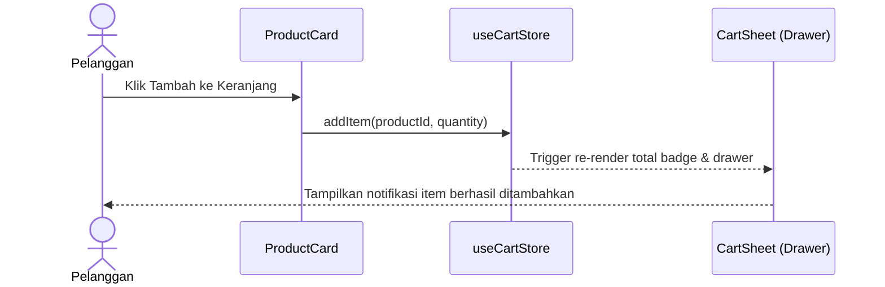

# Panduan Pembuatan Dokumentasi Frontend (MamaBear)

Panduan ini ditujukan untuk **Tim Frontend (FE)** agar dapat membuat dan memelihara dokumentasi teknis antarmuka, fitur toko, state management, dan komponen UI yang terintegrasi langsung di aplikasi **Fumadocs** repositori ini, dan otomatis tampil di:
👉 `https://vi-mamabear-frontend.vercel.app/docs/developer/frontend`

Semua dokumentasi teknis (baik Frontend maupun Backend) berada di bawah jalur aman `/docs/developer` yang dilindungi oleh autentikasi internal.

---

## 1. Alur Kontribusi Dokumentasi Tim FE

Berbeda dengan tim Backend yang berada di repositori terpisah, tim Frontend bekerja langsung di repositori utama `vi-mamabear-frontend`.

### Lokasi Berkas Dokumentasi
Seluruh berkas dokumentasi Frontend disimpan di:
```text
mamabear-frontend/
└── mamabear-docs/
    ├── content/
    │   └── docs/
    │       └── developer/
    │           └── frontend/      <-- Folder dokumentasi tim FE di sini
    └── public/
        └── docs/
            └── frontend/          <-- Aset gambar & screenshot UI di sini
```

### Kapan Developer FE Wajib Memperbarui Dokumentasi?
1. Saat membuat **fitur domain baru** di `src/features/` (misalnya: integrasi kurir, voucher diskon).
2. Saat menambahkan **state global baru** di `src/store/` (Zustand).
3. Saat memperkenalkan **komponen UI dasar baru** di `src/components/ui/` (shadcn/ui).
4. Saat ada perubahan variabel lingkungan (`.env.example`) atau konfigurasi route App Router.

---

## 2. Struktur Folder & Aturan Penamaan File

### 2.1 Struktur Folder Standar
```text
frontend/
├── meta.json              # Wajib: mengatur judul section dan urutan halaman di sidebar
├── index.mdx              # Wajib: halaman utama / ringkasan arsitektur frontend
├── arsitektur.mdx         # Penjelasan Next.js App Router & pola feature-driven
├── state-dan-api.mdx      # Pengelolaan state (Zustand) dan konsumsi API (openapi-fetch)
├── komponen-ui.mdx        # Panduan komponen shadcn/ui, Tailwind CSS, dan desain token
└── setup-lokal.mdx        # Cara clone, install, env vars, dan pengujian Jest
```

### 2.2 Aturan Penamaan File
1. **Gunakan format `kebab-case.mdx`**:
   - Selalu gunakan huruf kecil (*lowercase*) dan tanda strip (`-`).
   - Contoh **BENAR**: `manajemen-keranjang.mdx`, `auth-flow.mdx`, `chat-widget.mdx`.
   - Contoh **SALAH**: `ManajemenKeranjang.mdx`, `manajemen_keranjang.mdx`, `manajemen keranjang.mdx`.
2. **Ekstensi File Wajib `.mdx`**:
   - Gunakan ekstensi `.mdx` (bukan `.md`) agar dapat menggunakan komponen interaktif Fumadocs.
3. **File Utama Dinamakan `index.mdx`**:
   - Setiap folder wajib memiliki `index.mdx` yang berfungsi sebagai ringkasan folder tersebut.

---

## 3. Konfigurasi `meta.json` (Urutan Sidebar)

File `meta.json` mengatur daftar halaman dan urutan kemunculannya di sidebar Fumadocs.

**Contoh isi `meta.json`:**
```json
{
  "title": "Frontend Guide",
  "description": "Dokumentasi arsitektur, fitur toko, state management, dan komponen UI MamaBear Frontend.",
  "pages": [
    "index",
    "arsitektur",
    "state-dan-api",
    "komponen-ui",
    "setup-lokal"
  ]
}
```

> [!NOTE]
> Nama yang dimasukkan ke dalam array `pages` adalah nama file tanpa ekstensi `.mdx`. Jika membuat file baru (misal `checkout-flow.mdx`), daftarkan `"checkout-flow"` ke dalam array ini.

---

## 4. Format Dokumen MDX

Setiap file `.mdx` terdiri dari **Frontmatter** dan **Body**.

### 4.1 Format Frontmatter (Header Wajib)

Frontmatter diletakkan di baris paling awal file, diapit oleh tiga tanda strip (`---`):

```yaml
---
title: State Management & Integrasi API
description: Penggunaan Zustand untuk state global dan openapi-fetch untuk konsumsi REST API bertipe aman.
---
```

**Panduan Pengisian:**
- `title`: Judul halaman yang singkat dan padat (gunakan Title Case). **Jangan** memasukkan kata "Dokumentasi" agar sidebar tetap rapi.
  - *Baik*: `Arsitektur Frontend`, `Komponen UI & Styling`, `Setup Lokal FE`.
  - *Kurang baik*: `Dokumentasi Frontend MamaBear Bagian Komponen`.
- `description`: 1 atau 2 kalimat ringkas yang menjelaskan inti bahasan halaman.

---

### 4.2 Format Body (Isi Dokumen)

#### A. Aturan Heading (Judul Bab)
- **DILARANG menggunakan Heading 1 (`# Judul`)** di dalam body, karena H1 sudah otomatis dibuat oleh Fumadocs dari `title` di frontmatter.
- Gunakan **`##` (Heading 2)** untuk topik utama.
- Gunakan **`###` (Heading 3)** untuk sub-topik.
- Gunakan **`####` (Heading 4)** untuk poin detail (misal properti props komponen).

#### B. Komponen Fumadocs yang Tersedia

##### 1. Callout (Catatan, Peringatan, Tips)
Gunakan untuk menandai informasi penting atau catatan developer:

```mdx
<Callout type="info">
  Komponen ini merupakan Client Component dan wajib memiliki direktif `'use client'` di baris paling atas.
</Callout>

<Callout type="warn">
  Hindari memanggil API backend langsung di Client Component tanpa menggunakan hook atau helper yang terstandarisasi.
</Callout>

<Callout type="error">
  Jangan mengekspos `NEXTAUTH_SECRET` ke sisi browser. Hanya gunakan prefix `NEXT_PUBLIC_` untuk variabel yang aman dilihat publik.
</Callout>
```

##### 2. Tabs (Perbandingan Server vs Client Component atau Tampilan)
Sangat cocok untuk menunjukkan variasi implementasi:

````mdx
<Tabs items={['Server Component', 'Client Component']}>
  <Tab value="Server Component">
    ```tsx title="src/features/products/components/product-list.tsx"
    import { getProducts } from '../api/get-products';
    import { ProductCard } from './product-card';

    export async function ProductList() {
      const products = await getProducts();
      return (
        <div className="grid grid-cols-2 md:grid-cols-4 gap-4">
          {products.map((p) => (
            <ProductCard key={p.id} product={p} />
          ))}
        </div>
      );
    }
    ```
  </Tab>
  <Tab value="Client Component">
    ```tsx title="src/features/products/components/add-to-cart-button.tsx"
    'use client';

    import { useCartStore } from '@/store/use-cart-store';
    import { Button } from '@/components/ui/button';

    export function AddToCartButton({ productId }: { productId: string }) {
      const addItem = useCartStore((s) => s.addItem);
      return <Button onClick={() => addItem(productId)}>Beli Sekarang</Button>;
    }
    ```
  </Tab>
</Tabs>
````

##### 3. Code Blocks dengan Judul File & Highlight
Selalu sertakan atribut bahasa (`tsx`, `ts`, `bash`) dan judul file `title="..."`:

````mdx
```tsx title="src/store/use-cart-store.ts" {6-8}
import { create } from 'zustand';

interface CartState {
  items: CartItem[];
  addItem: (item: CartItem) => void;
  clearCart: () => void;
}

export const useCartStore = create<CartState>((set) => ({
  items: [],
  addItem: (item) => set((state) => ({ items: [...state.items, item] })),
  clearCart: () => set({ items: [] }),
}));
```
````

##### 4. Steps (Panduan Langkah Demi Langkah)
Gunakan untuk panduan instalasi, konfigurasi, atau penambahan fitur baru:

```mdx
<Steps>
  <Step>
    #### Buat Folder Fitur Baru
    Buat folder baru di bawah `src/features/nama-fitur/` dengan sub-folder `components`, `hooks`, dan `types`.
  </Step>

  <Step>
    #### Hubungkan ke Routing
    Tambahkan file `page.tsx` di `src/app/(shop)/nama-fitur/page.tsx`.
  </Step>

  <Step>
    #### Jalankan Pengujian
    Pastikan linter dan unit test lolos:
    ```bash
    npm run lint && npm run test
    ```
  </Step>
</Steps>
```

##### 5. Cards & CardGrid (Navigasi Fitur Visual)
Gunakan untuk menghubungkan halaman terkait:

```mdx
<Cards>
  <Card title="Arsitektur Toko" href="/docs/developer/frontend/arsitektur" description="Pola pemisahan Server & Client Components." />
  <Card title="Komponen UI" href="/docs/developer/frontend/komponen-ui" description="Daftar komponen shadcn/ui dan konvensi styling." />
</Cards>
```

##### 6. Diagram Alur (Mermaid)
Tulis diagram alur data, interaksi antar komponen, atau alur autentikasi tanpa perlu membuat gambar manual:

````mdx
```mermaid
flowchart TD
    User([Pelanggan]) -->|Klik Checkout| CartView[Cart Page]
    CartView --> AuthCheck{Sudah Login?}
    AuthCheck -->|Belum| LoginPage[Redirect Login]
    AuthCheck -->|Sudah| CheckoutFlow[Checkout Form]
    CheckoutFlow -->|Submit Order| APIRoute[/api/backend/orders]
    APIRoute --> BackendServer[(Backend Render)]
```
````

---

## 5. Panduan Menyematkan Screenshot UI & Aset Desain

Dokumentasi frontend sangat mengandalkan visual untuk mendemonstrasikan perilaku antarmuka pengguna.

### 5.1 Standar Pengambilan Tangkapan Layar (Screenshot)
1. **Resolusi Standar**:
   - **Desktop View**: Tangkap dengan lebar viewport minimal `1280px` atau `1440px`.
   - **Mobile View**: Tangkap dengan viewport `375px` (iPhone) atau `390px`.
2. **Format Berkas**:
   - Gunakan format **PNG** (untuk gambar tajam/teks) atau **WebP**.
   - Kompres berkas gambar (target di bawah 400 KB per gambar) menggunakan alat seperti TinyPNG atau Squoosh.
3. **Penyimpanan Berkas**:
   - Simpan berkas gambar di folder lokal docs:
     `mamabear-docs/public/docs/frontend/`

### 5.2 Format Pemanggilan di MDX

Gunakan sintaks gambar Markdown dengan *alt text* deskriptif:

```mdx

```

Jika ingin menyandingkan tampilan Desktop dan Mobile:

````mdx
<Tabs items={['Tampilan Desktop', 'Tampilan Mobile']}>
  <Tab value="Tampilan Desktop">
    
  </Tab>
  <Tab value="Tampilan Mobile">
    
  </Tab>
</Tabs>
````

---

## 6. Template MDX Siap Pakai untuk Fitur Baru

Silakan salin template di bawah saat membuat dokumentasi modul/fitur frontend baru:

````mdx
---
title: Fitur Manajemen Keranjang (Cart)
description: Arsitektur komponen keranjang, sinkronisasi state lokal dengan server, dan perhitungan diskon.
---

Modul keranjang belanja (`src/features/cart`) mengelola item yang dipilih oleh pelanggan sebelum melanjutkan ke tahap pembayaran.

## Struktur Komponen

Modul ini terdiri dari beberapa komponen utama:

```text
src/features/cart/
├── components/
│   ├── cart-sheet.tsx          # Drawer keranjang mengambang
│   ├── cart-item-row.tsx       # Baris item per produk
│   └── cart-summary.tsx        # Rincian subtotal & estimasi ongkir
├── hooks/
│   └── use-cart-calculations.ts # Kalkulasi kupon & total belanja
└── index.ts                    # Public export untuk fitur lain
```

## Alur State Management

Keranjang disimpan di memori klien menggunakan **Zustand** dengan persistensi `localStorage`:



<Callout type="info">
  Saat pelanggan login, item keranjang lokal akan disinkronkan secara otomatis dengan keranjang di server backend.
</Callout>

## Contoh Penggunaan Hook

```tsx title="src/features/cart/hooks/use-cart-calculations.ts"
import { useCartStore } from '@/store/use-cart-store';

export function useCartCalculations() {
  const items = useCartStore((s) => s.items);
  const subtotal = items.reduce((acc, item) => acc + item.price * item.quantity, 0);
  const totalItems = items.reduce((acc, item) => acc + item.quantity, 0);

  return { subtotal, totalItems };
}
```
````

---

## 7. Pengujian Lokal & Checklist Review

Sebelum membuat Pull Request atau melakukan commit perubahan dokumentasi:

### Uji Coba Lokal
Dari folder `mamabear-docs`:
```bash
# 1. Jalankan development server dokumentasi
npm run dev

# 2. Periksa kesesuaian type TypeScript
npm run types:check

# 3. Uji coba kompilasi build produksi
npm run build
```

Buka `http://localhost:3001/docs/developer/frontend` di browser dan pastikan seluruh halaman dapat dibuka dengan lancar.

### Checklist Review
- [ ] Berkas disimpan di `mamabear-docs/content/docs/developer/frontend/`.
- [ ] Nama berkas menggunakan format `kebab-case.mdx`.
- [ ] Berkas telah memiliki frontmatter `title` dan `description`.
- [ ] Nama berkas telah didaftarkan ke dalam array `pages` di `meta.json`.
- [ ] Tidak ada penggunaan `#` (H1) di dalam body dokumen.
- [ ] Seluruh blok kode menyertakan atribut bahasa pemrograman dan judul berkas.
- [ ] Seluruh gambar screenshot disimpan di `public/docs/frontend/` dan memiliki teks alternatif yang jelas.

