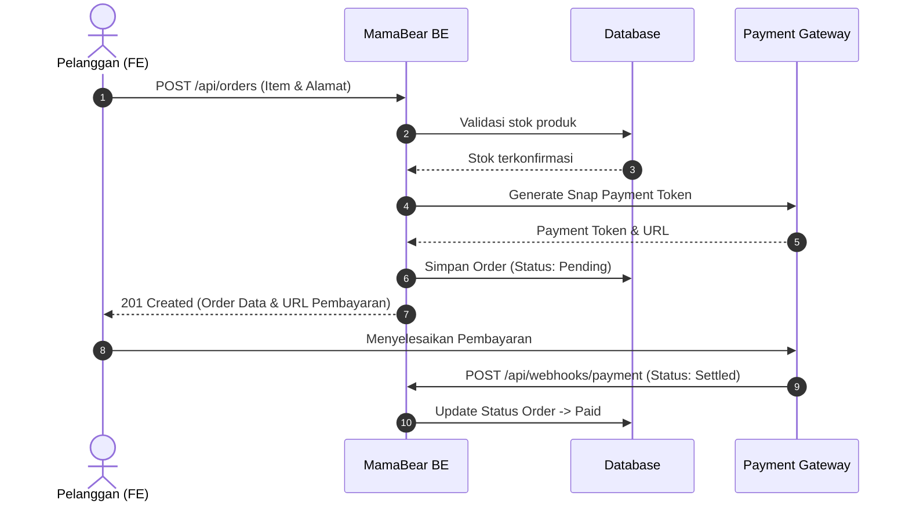

MamaBear Backend mengekspos endpoint RESTful API berbasis JSON. Halaman ini mendefinisikan standar format respons, kode status HTTP, serta katalog endpoint utama.

## Konvensi Standar Respons JSON

Semua endpoint mengembalikan struktur respons yang konsisten:

<Tabs items={['Respons Sukses', 'Respons Error Validasi (400)', 'Respons Unauthorized (401)']}>
  <Tab value="Respons Sukses">
    ```json
    {
      "status": "success",
      "message": "Data produk berhasil diambil",
      "data": [
        {
          "id": "prod_01",
          "name": "MamaBear Teh Pelancar ASI",
          "price": 42000,
          "stock": 50,
          "category": "teh-herbal"
        }
      ]
    }
    ```
  </Tab>
  <Tab value="Respons Error Validasi (400)">
    ```json
    {
      "status": "fail",
      "message": "Validasi gagal",
      "errors": [
        {
          "field": "email",
          "message": "Format email tidak valid"
        }
      ]
    }
    ```
  </Tab>
  <Tab value="Respons Unauthorized (401)">
    ```json
    {
      "status": "error",
      "message": "Token tidak valid atau sesi telah kedaluwarsa"
    }
    ```
  </Tab>
</Tabs>

---

## Autentikasi & Authorization

Untuk mengakses endpoint privat (user profile, orders, checkout, admin), sertakan JSON Web Token (JWT) di HTTP Header:

```http
Authorization: Bearer <YOUR_JWT_TOKEN>
```

<Callout type="info">
  Token JWT memiliki masa berlaku 7 hari. Refresh token diatur secara otomatis saat user melakukan login ulang.
</Callout>

---

## Katalog Endpoint Utama

| Method | Endpoint | Akses | Keterangan |
| :--- | :--- | :--- | :--- |
| `POST` | `/api/auth/register` | Publik | Mendaftarkan akun pelanggan baru |
| `POST` | `/api/auth/login` | Publik | Otentikasi dan penerbitan token JWT |
| `GET` | `/api/auth/profile` | Authed | Mendapatkan profil akun yang sedang login |
| `GET` | `/api/products` | Publik | Daftar katalog produk dengan filter & pagination |
| `GET` | `/api/products/:id` | Publik | Detail lengkap satu produk |
| `POST` | `/api/orders` | Authed | Membuat pesanan baru dan menghasilkan link bayar |
| `GET` | `/api/orders/user` | Authed | Daftar riwayat pesanan milik pengguna |
| `POST` | `/api/webhooks/payment` | Webhook | Menerima callback status pembayaran dari payment gateway |

---

## Contoh Alur Pemesanan (Sequence Diagram)



