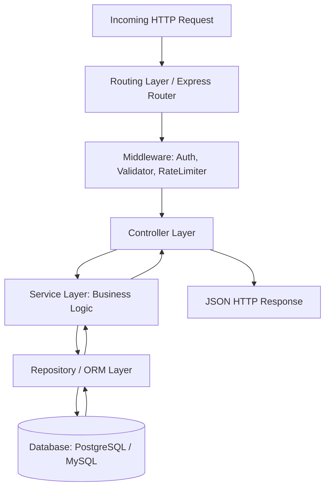

Layanan Backend MamaBear dirancang menggunakan arsitektur berlapis (*layered architecture*) untuk memastikan pemisahan tanggung jawab (*separation of concerns*), kemudahan pengujian (*unit testing*), serta skalabilitas kode.

## Pola Layering

Setiap permintaan HTTP yang masuk diproses melalui tahapan berikut:



### 1. Routes & Middleware
- Bertanggung jawab menerima request HTTP dan memetakan ke handler controller yang sesuai.
- Menjalankan validasi skema (menggunakan Joi atau Zod) dan verifikasi token autentikasi (JWT).

### 2. Controllers
- Menerima input dari request (`req.body`, `req.params`, `req.query`).
- Memanggil fungsi pada **Service Layer**.
- Mengembalikan response JSON seragam beserta status code yang tepat. Controller tidak boleh mengandung query database langsung.

### 3. Services (Business Logic)
- Mengandung seluruh aturan bisnis MamaBear (misalnya: kalkulasi diskon, validasi stok sebelum checkout, pemrosesan pembayaran).
- Mengorkestrasi interaksi data melalui Repository.

### 4. Repository / Data Access (ORM)
- Mengelola query langsung ke database menggunakan ORM (seperti Prisma / TypeORM / Sequelize).
- Mengisolasi logika database agar service tetap independen dari jenis database yang digunakan.

---

## Struktur Direktori Backend

Berikut adalah konvensi struktur folder pada repositori `vi-mamabear-backend`:

```text
src/
├── config/             # Konfigurasi database, env, dan third-party services
├── controllers/        # Request handlers per domain
├── middlewares/        # Auth, error handling, rate-limiting, request logging
├── models/             # Schema ORM / Database models
├── repositories/       # Query data access layer
├── routes/             # Definisi endpoint API
├── services/           # Logika bisnis utama
├── utils/              # Helper functions, formatters, dan konstanta
└── app.ts              # Entrypoint inisialisasi aplikasi Express
```

<Callout type="warn">
  Pastikan seluruh operasi database yang melibatkan lebih dari satu entitas terkait (misalnya create order dan pemotongan stok) dibungkus dalam **database transaction** untuk mencegah inkonsistensi data.
</Callout>

