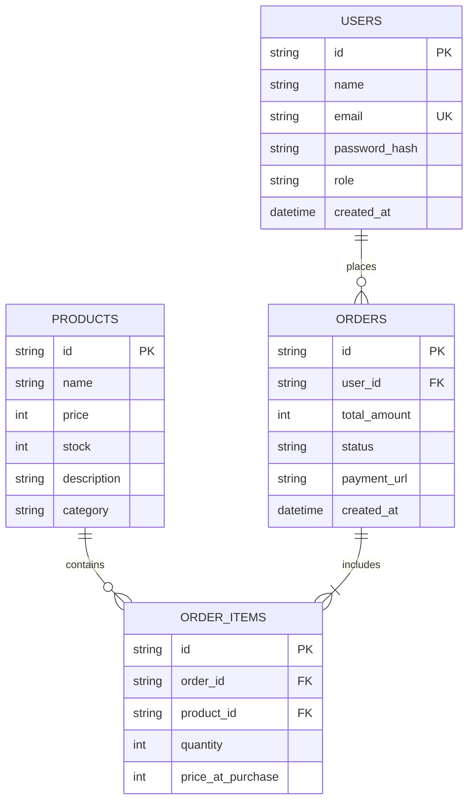

Dokumen ini menjelaskan struktur basis data yang digunakan oleh layanan Backend MamaBear.

## Entity Relationship (ERD Ringkas)



---

## Manajemen Migrasi Database

Seluruh perubahan skema basis data wajib dicatat melalui skrip migrasi agar dapat direproduksi di lingkungan lokal, staging, dan production.

<Steps>
  <Step>
    #### Membuat File Migrasi Baru
    Jika ada penambahan kolom atau tabel baru:
    ```bash
    npm run migration:generate -- name_of_migration
    ```
  </Step>

  <Step>
    #### Menjalankan Migrasi ke Database Lokal
    ```bash
    npm run migration:run
    ```
  </Step>

  <Step>
    #### Menjalankan Seeder (Data Awal Produk & Admin)
    ```bash
    npm run seed
    ```
  </Step>
</Steps>

<Callout type="warn">
  Jangan pernah mengubah file migrasi yang sudah pernah di-merge dan dijalankan pada database production. Selalu buat file migrasi baru untuk setiap perubahan skema.
</Callout>

