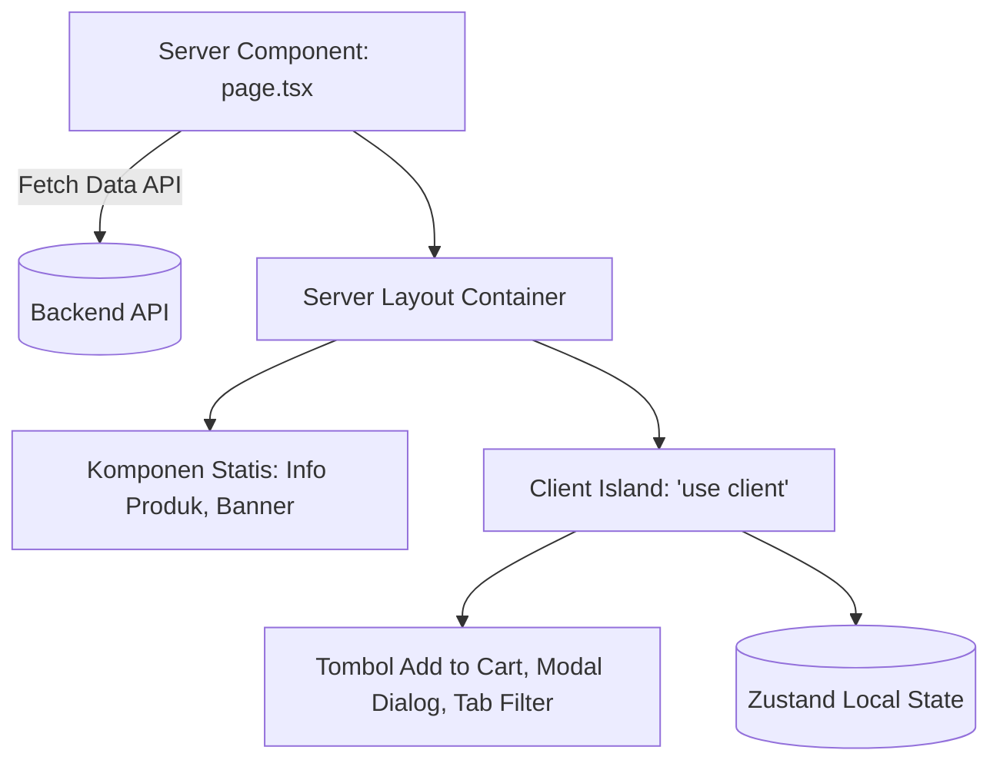

Aplikasi toko MamaBear menerapkan **Feature-Driven Architecture** di dalam **Next.js App Router** untuk menjaga kode tetap rapi, mudah didekati oleh tim baru, dan terisolasi per domain bisnis.

## Struktur Direktori Utama

```text
src/
├── app/                # Next.js App Router (Routing, Layouts, Metadata)
│   ├── (auth)/         # Rute autentikasi (login, register)
│   ├── (shop)/         # Rute katalog publik toko dan checkout
│   └── admin/          # Rute portal dashboard admin
├── features/           # Domain-driven features (logika per modul bisnis)
│   ├── products/       # Katalog, detail produk, filter, pagination
│   ├── cart/           # Keranjang belanja, perhitungan subtotal
│   ├── checkout/       # Form checkout, pemilihan ekspedisi & pembayaran
│   ├── orders/         # Riwayat pesanan & tracking status
│   ├── chat/           # Widget konsultasi MamaBear Care
│   ├── auth/           # Form login/register dan sinkronisasi sesi
│   └── admin/          # Komponen tabel, charts, dan kelola produk
├── components/         # Komponen UI global (shared / re-usable)
│   └── ui/             # Komponen shadcn/ui primitif (Button, Dialog, Input)
├── store/              # Global state management (Zustand)
├── lib/                # Klien API, konfigurasi NextAuth, dan helper umum
└── types/              # Type definitions dan skema OpenAPI ter-generate
```

---

## Prinsip Pemisahan Komponen

Kami menerapkan aturan ketat mengenai pemisahan antara **Server Components** dan **Client Components**:



### 1. Server Components (Default)
- Seluruh file `page.tsx` dan `layout.tsx` adalah Server Components secara default.
- Mengambil data awal (*initial data fetching*) di server untuk performa SEO optimal dan waktu muat cepat.
- Tidak boleh menggunakan React Hooks (`useState`, `useEffect`) atau event listeners (`onClick`).

### 2. Client Components (`'use client'`)
- Hanya digunakan pada komponen interaktif yang memerlukan interaksi pengguna, event browser, atau state lokal (misalnya: drawer keranjang, input form, tombol tambah ke keranjang, dan chat widget).
- Jadikan Client Component sekecil mungkin (*leaf node*) agar tidak mengorbankan performa Server Rendering.

---

## Struktur Modul Fitur (`src/features/*`)

Setiap domain bisnis di `src/features/` memiliki struktur modular mandiri:

```text
src/features/products/
├── components/         # Komponen tampilan khusus produk
│   ├── product-card.tsx
│   ├── product-grid.tsx
│   └── product-filter.tsx
├── hooks/              # Custom hooks untuk manipulasi data produk
├── api/                # Helper pemanggilan endpoint produk
└── types.ts            # Tipe data khusus domain produk
```

<Callout type="info">
  Halaman di `src/app/(shop)/products/page.tsx` bertindak sebagai perakit (*assembler*) yang mengimpor komponen dari `src/features/products`.
</Callout>

